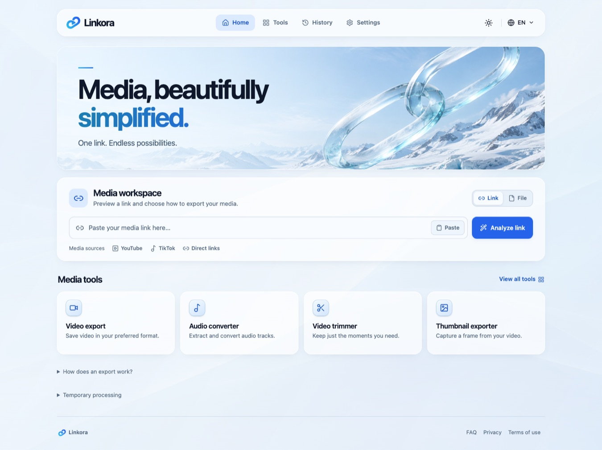

# Linkora

Media, beautifully simplified. Linkora is a single-process Next.js media utility. Paste an eligible link, select an output, follow its progress and download the validated file. A separate workflow accepts local files. The Glacier Blue and Ocean Blue interface supports English and Khmer, light and dark appearances, keyboard navigation and reduced motion.



## Run with Docker

From the repository root, run the following command and open [Linkora locally](http://127.0.0.1:10000).

```sh
docker compose up --build -d
```

The image includes Node.js, Python, yt-dlp, FFmpeg and FFprobe. The application runs as the unprivileged node user. Check installed engine versions at `/api/v1/health`. Compose mounts bounded temporary storage in memory. On memory-constrained hosts, use ordinary ephemeral container storage as the Render deployment does. Stop a Compose installation with `docker compose down`.

[View the mobile export workspace in dark appearance](docs/mobile-export.jpg)

## Which links can export?

| Source | Eligibility |
| --- | --- |
| YouTube | Single videos, Shorts, mobile, music and short URLs normalize to a video ID. Playlist/radio tracking parameters are discarded. Set the comma-separated `AUTHORIZED_YOUTUBE_IDS` only for videos whose rights holder **and platform** permit this server-side use. The operator maintains this list. The service also requires accessible, unprotected media tracks within its limits. Other public videos can return an oEmbed preview and the reason export is unavailable. |
| TikTok | Accepts canonical posts and supported short URLs. The post must explicitly enable downloads and supply a downloadable publisher rendition. Playback-only renditions cannot qualify. The extractor and public page can differ by post and hosting region. |
| Approved media URLs | Accepts public HTTPS files on exact hostnames in `DIRECT_MEDIA_HOSTS`. Provide only hosts and media authorized for this use. Linkora retrieves and probes the actual file on analysis. Try the [W3C-hosted Big Buck Bunny trailer](https://media.w3.org/2010/05/bunny/trailer.mp4). |
| Local media | Upload through the file workflow to analyze streams, dimensions and duration. No external media provider is involved. |
| Vimeo and SoundCloud | Public embed metadata when available. Export is unavailable through these adapters. |

A format in the selector describes a producible output. FFmpeg can downscale a larger source and encode an MP3 at the selected bitrate. It cannot add source detail. MP4 presets include best available within the server cap, 1080p, 720p, 480p and 360p. Audio-only inputs expose audio outputs. The interface shows estimates when available and reports the exact size after completion. If the platform refuses access, expiry, login, geographic restrictions or disabled downloads may prevent export even after a successful preview.

## Native development

Use Node.js 22.13+ with npm, Python 3.11+ and an FFmpeg distribution with FFprobe, H.264, AAC, LAME, VP9 and Opus. On macOS, Homebrew supplies the native tools. The general-purpose tooling command is `brew install yt-dlp ffmpeg deno`. Linkora invokes a pinned Python installation of yt-dlp in isolated mode. Its retrieval policy disables JavaScript challenge runtimes, so Deno is optional. Install Python and Node if needed. On Debian or Ubuntu, install `ffmpeg python3 python3-venv` using apt and use a supported Node.js installation.

```sh
python3 -m venv .venv
.venv/bin/python -m pip install 'yt-dlp==2026.11.23'
export PYTHON_BIN="$PWD/.venv/bin/python"
npm ci
npm run dev
```

Development normally listens on port 3000. For the production server, use `npm run build` followed by `PORT=10000 npm run start`. The build script copies static assets and the guarded extractor into the standalone bundle. Native deployments require those tools at runtime. Use a dedicated temporary directory for each running server process.

## Architecture and storage

The App Router renders the pages. Client components handle clipboard, preferences, upload, format selection and SSE. The same Node process owns the API, bounded FIFO queue and private working directory. It invokes engines with argument arrays via `child_process.spawn`. There is no database, storage account or separate worker to provision.

| Location | Responsibility |
| --- | --- |
| `src/app`, `src/components` | Pages, Glacier Glass workspace, tools, history, settings and progress UI |
| `src/app/api/v1/[...path]/route.ts` | Validation, anonymous sessions, API responses, event streams and file delivery |
| `src/lib/server/providers*`, `urls.ts` | Provider eligibility, normalization, public destination checks and format discovery |
| `src/lib/server/retrieve.ts`, `native.ts`, `scripts/extractor.py` | Bounded retrieval, child lifecycle and provider-specific network restrictions |
| `src/lib/server/jobs.ts`, `storage.ts`, `media.ts` | Reservations, queue, cleanup, probing, merging, conversion and output validation |
| `tests` | Unit, native-worker, HTTP integration and browser checks |
| `Dockerfile`, `docker-compose.yml`, `render.yaml` | Build, local operation and single-instance Render deployment |

Jobs expose queue, retrieval, processing and finalization stages. Progress, speed, remaining time and byte counts come from the engines when available. Closing the progress stream leaves the job running. Cancellation terminates the active child. Retry creates a new job while its analyzed source is available. Completed output is session-private and expires after **15 minutes** by default. Active readers can finish. The sweeper removes expired, unreferenced analysis inputs. On restart, orphaned job/source directories inside the dedicated working directory are purged. Browser history is a local preference and can outlive a file.

The workspace also supports trimming, compression, resizing, frame export, audio volume/fades, compatible container conversion and extraction of available subtitle tracks. Batch processing is opt-in. A feature or output can be unavailable for a particular input, server configuration or encoder.

## Configuration

See [.env.example](.env.example) for every default. Set values in the server environment. Compose passes through `AUTHORIZED_YOUTUBE_IDS`; add other overrides to the Compose service environment when needed.

| Variables | Defaults or meaning |
| --- | --- |
| `PORT`, `TEMP_DIR`, `SITE_URL` | Container 10000, /tmp/linkora, optional canonical deployment URL |
| `MAX_FILE_SIZE_MB`, `MAX_UPLOAD_SIZE_MB`, `MAX_TEMP_STORAGE_MB` | 100 MiB per file, 100 MiB per upload, 512 MiB total reservations |
| `MAX_VIDEO_DURATION_SECONDS`, `MAX_VIDEO_HEIGHT` | 600 seconds, 1080 maximum output height |
| `MAX_CONCURRENT_JOBS`, `MAX_QUEUE_SIZE`, `MAX_JOBS_PER_SESSION` | 1 active worker, 5 waiting, 1 outstanding job per session |
| `JOB_TIMEOUT_SECONDS`, `FILE_TTL_SECONDS`, `CLEANUP_INTERVAL_SECONDS` | 300 seconds per job, 900 seconds retention, 60 seconds between sweeps |
| `ENABLE_LOCAL_UPLOADS`, `ENABLE_HEAVY_TRANSCODING` | Enabled; disable heavy conversion to conserve CPU |
| `ENABLE_DIRECT_URL_EXPORT`, `DIRECT_MEDIA_HOSTS` | Enabled for media.w3.org and interactive-examples.mdn.mozilla.net by default |
| `AUTHORIZED_YOUTUBE_IDS` | Empty by default; operator-verified IDs only |
| `ENABLE_BATCH_EXPORT`, `MAX_BATCH_SIZE` | Disabled, maximum 3 by default |
| `PYTHON_BIN`, `FFMPEG_BIN`, `FFPROBE_BIN` | Optional explicit executable paths |

## API

Use the same session cookie for analysis, export, progress and download. JSON requests require `Content-Type: application/json`. Normal JSON responses include `success`, `code`, `message` and `data`. All paths below start with `/api/v1/`.

| Method and path | Request or response |
| --- | --- |
| GET health, limits, platforms | Installed tools, effective limits and supported provider policies |
| POST media/analyze | `{"url":"https://media.w3.org/2010/05/bunny/trailer.mp4"}` returns metadata, source ID and eligible format IDs |
| POST media/upload | Raw file bytes with URL-encoded original filename in the X-Filename header |
| POST media/export or media/process | `{"mediaId":"<analysis id>","format":"mp3-192"}`, optional validated edit object. Returns HTTP 202 and a job ID. |
| GET jobs/{id} | Current snapshot, including error or completion details |
| GET jobs/{id}/progress | Server-sent events, immediate snapshot and subsequent changes |
| DELETE jobs/{id} | Cancel pending or active work |
| POST jobs/{id}/retry | Retry a failed or cancelled job |
| GET jobs/{id}/download | Stream the completed file as an attachment |

Write operations enforce origin checks and rate limits. Random, signed HttpOnly cookies bind analysis and jobs to a session. The server validates provider hostnames, public IPs and redirects and restricts native media demuxers. Extraction runs without browser cookies, arbitrary URLs from clients, shell interpolation or remote challenge components. Private media, DRM, unsupported protocols and restricted downloads are ineligible. File expiry, size quotas and deadlines also apply to failed or cancelled work.

## Verification

```sh
npm run lint
npm run typecheck
npm test
npm run test:engine
npm run build
```

Against a running server, run `npm run test:integration` and `npm run test:e2e`. Set `TEST_BASE_URL` if the origin differs from http://127.0.0.1:10000. Both suites need local media binaries. Install Playwright Chromium with `npx playwright install chromium` or provide a compatible `CHROME_PATH`. The HTTP suite generates a controlled video with sound and captions, downloads exports and checks them using FFprobe. To exercise expiry quickly, run an isolated test server with `FILE_TTL_SECONDS=25` and `CLEANUP_INTERVAL_SECONDS=1`. The engine suite creates its own temporary root.

The browser suite verifies real MP3 and MP4 downloads from the approved W3C link, local history, Khmer settings and four screens at six widths in both themes. Set `TEST_MEDIA_URL` to test a different authorized source. Network or provider refusals are real outcomes. The worker and HTTP suites run with locally generated fixtures.

### Verified on macOS and in Linux Docker

The Docker browser test normalized a user-authorized YouTube radio URL to its single video, received progress events, downloaded both outputs and inspected them with FFprobe. The 1080p MP4 contained H.264 video and AAC audio (207.262 seconds, 92,022,404 bytes). The 192 kbps MP3 was 207.308 seconds and 4,976,132 bytes. A native worker also produced a validated 640×360 MP4 from the same source. This permission was scoped to the local test configuration. An earlier best-quality run hit the five-minute job deadline, which led to preferring compatible tracks and reusing them during merging.

The native and Docker HTTP tests covered session isolation, reconnecting progress streams, cancellation, retry and expiry using a shortened retention period. The default remains 900 seconds. Browser checks covered four primary screens and 14 secondary routes in both themes. The accessibility scan found no automated WCAG A/AA violations on Home, Tools, History or Settings at the tested phone and desktop sizes. Live Render behavior and a positive TikTok export remain unverified.

## Render

1. Push the repository, including the lockfile and render.yaml, to a GitHub repository accessible to your Render account.
2. Create a Blueprint in Render, select the repository and apply its Docker web service configuration on main.
3. Keep one instance, configure any operator-approved sources and set SITE_URL to the public HTTPS origin. Render provides PORT. No persistent disk is needed.
4. Check /api/v1/health and run an authorized MP4 and MP3 download through the deployed origin. Confirm progress and file validity from that region before advertising platform-specific support.

Render restarts and idle shutdowns lose in-memory jobs and temporary files. Multiple replicas cannot share sessions, queue state or downloads. CPU limits and provider restrictions on hosting IPs can affect individual jobs.

## Troubleshooting and follow-up

- **Preview with no formats.** Read the reason displayed on the card. Check verified permission, platform download controls and host policy. If a signed rendition expired, analyze the original link again.
- **Dependency error on startup.** Check PYTHON_BIN and its installed yt-dlp module. Verify FFmpeg and FFprobe are executable and that the required encoders are present. The production image includes a compatible set.
- **Queue, file-size or timeout error.** Wait for a slot, choose a smaller output or analyze a shorter source. Completed output still consumes storage until expiry.
- **Expired or missing download.** Reanalyze in the same browser and export again. A deployment restart also invalidates the signed session.
- **Progress stalls behind a proxy.** Forward the event stream without buffering and allow connections longer than the job. Reconnecting returns the latest snapshot.

Deployment follow-up includes a live Render smoke test and a positive export test on a TikTok post with a publisher-enabled downloadable rendition. Provider behavior can change independently of this release.
